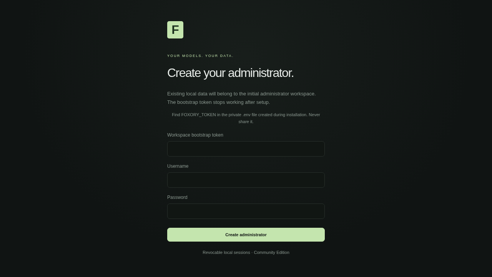
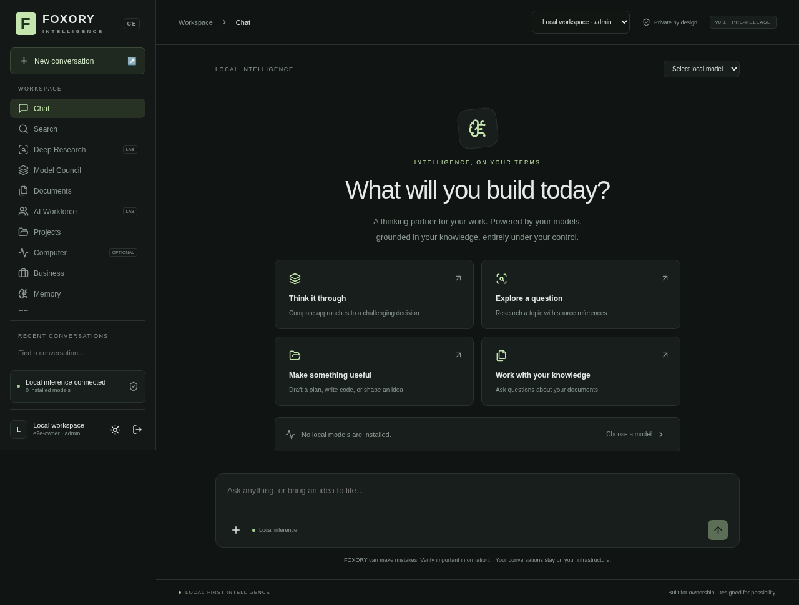
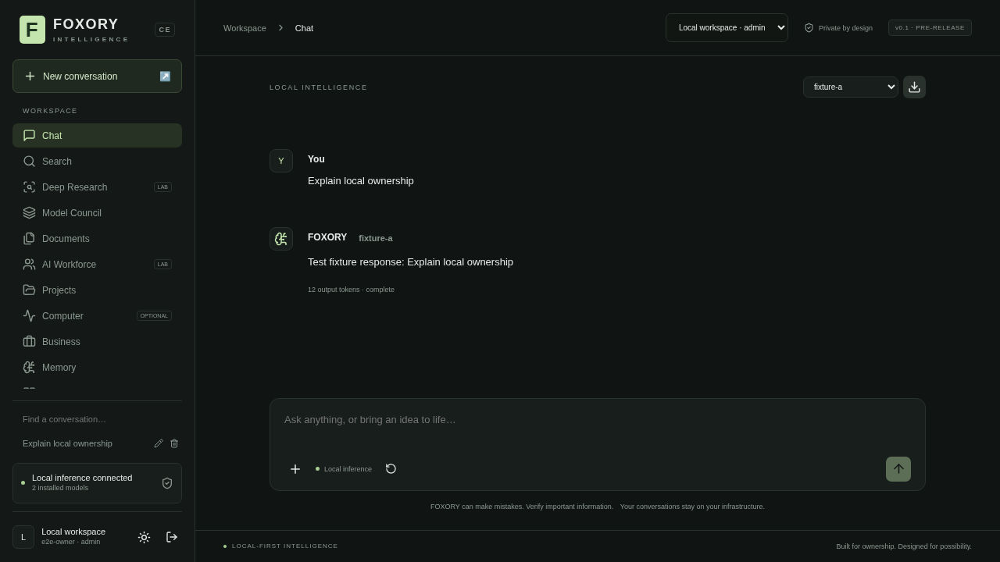
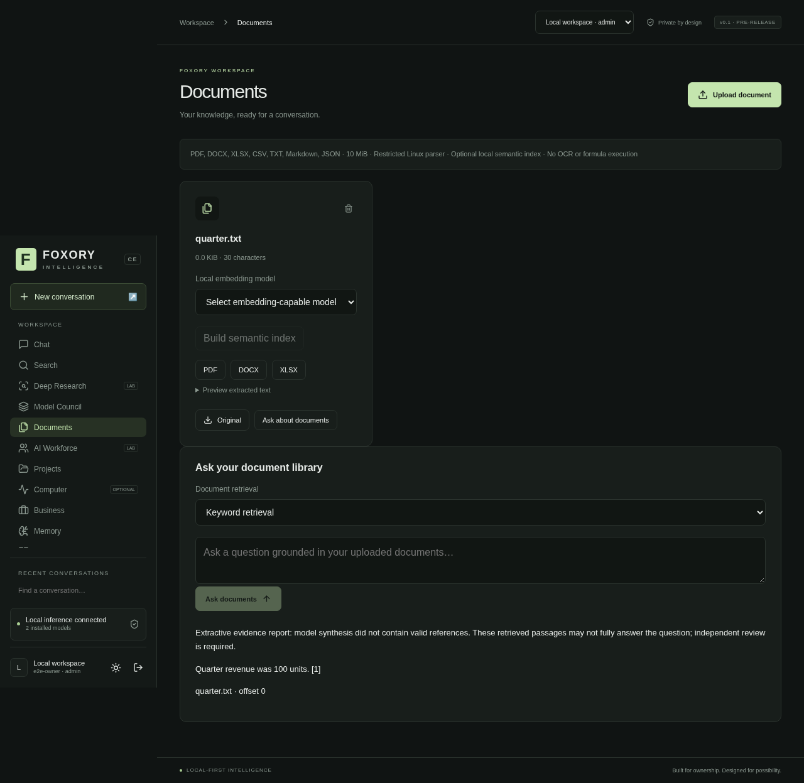
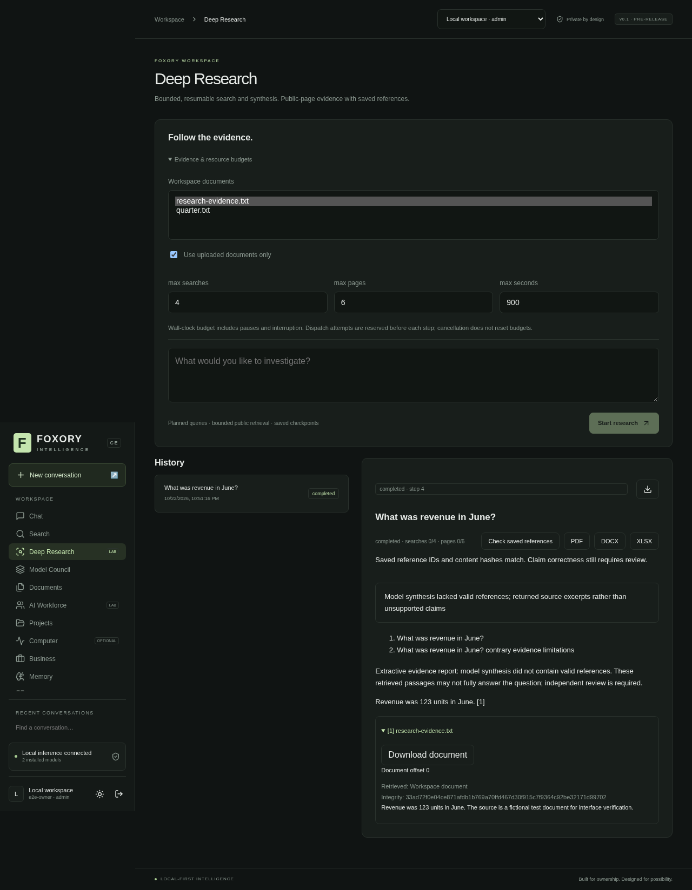
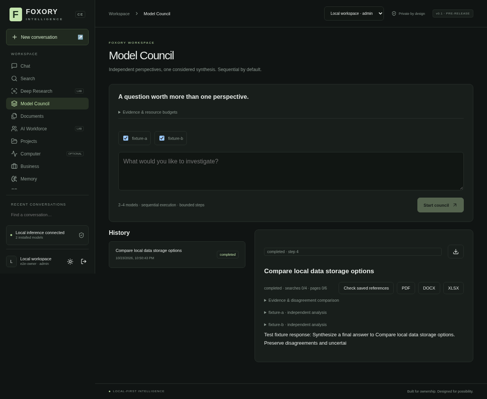
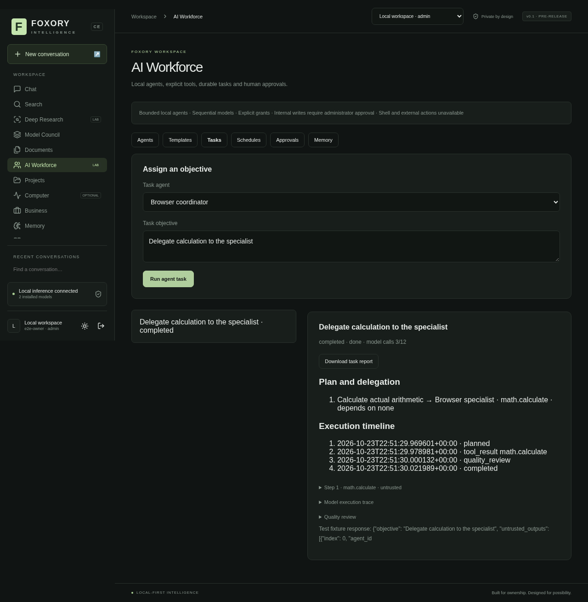
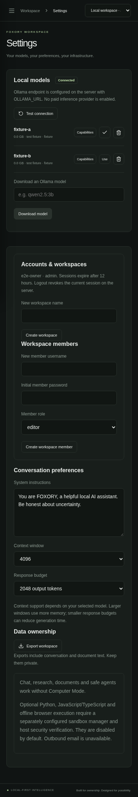

# Core product recovery and verification

This increment continues Phase 4 and repairs the existing core product. Phases
1–3 remain accepted; Phase 4 remains incomplete and Phase 5 has not started.
The authoritative current feature matrix/results are in PROJECT_STATUS.md.

## Repository reconciliation

Before editing, Cloud `development`, its configured private origin and GitHub's
actual remote development ref were checked and matched
`aab7884e6a598f4cde1d9f06d4342cc20fb0be08`. The working tree was clean. The owner's
later Ubuntu pull also reached that commit, superseding the pasted directive's
older assumption that the fix was still unpushed. No divergence, history rewrite,
branch deletion, repository recreation or unrelated project change was needed.
Codex has no direct access to the owner's Ubuntu filesystem.

The owner then supplied real Ubuntu JS/TS/Chromium fixed-probe passes; see
[the separately scoped evidence](UBUNTU_OCI_RUNTIME_EVIDENCE.md). This is not a
general sandbox-security certification or a core-install prerequisite.

## Architecture findings

The existing modular monolith is appropriate for the supported single-process
deployment. Authentication, workspace-scoped persistence, inference, research,
documents, agents and reports have separate modules. Durable jobs/scheduling use
the same process and persistent database. Do not add services or replace these
working modules without evidence. Scaling beyond one API process still needs
distributed leases/limits and remains unsupported.

Default Compose consists of application, PostgreSQL and Ollama only, binds the
web UI to loopback, and persists application/database/model data in named volumes.
There is no sandbox service/runtime socket. Core native acceptance explicitly
sets sandbox enablement to zero, clears manager connection settings and starts
no manager. Linux restricted document parsing is a separate, established parser
boundary; it does not require rootless Podman or an execution OS account.

The principal problems found were integration/quality issues, not a need for a
new architecture: inconsistent citation handling between Search and Deep
Research, silent stale-model selection, missing no-model guidance and conflicting
optional-execution copy. Generic workspace Record envelopes and dense frontend
components remain maintenance risks; this increment does not rewrite schemas,
discard legacy business records or expand business modules.

## Confirmed defects and repairs

1. Actual local `qwen2.5:0.5b` Search chat retrieved genuine pages but displayed
   inaccurate model prose with no valid numeric citations. Deep Research already
   had a safe extractive fallback. Search/document chat now share that reference
   check/fallback; uncited prose is discarded, not decorated with invented
   citations. Missing usable document evidence skips model inference. Saved
   hashes/IDs still do not establish that a cited model claim is true.
2. A browser regression reproduced an unavailable saved model: the selector
   displayed an empty value instead of recovering to an installed model. Model
   refresh now validates selected/default and Council selections against installed
   names. Connected Ollama with zero models has a visible Settings action.
3. Screenshot review showed no instruction for locating the first-run bootstrap
   token and stale claims about Computer availability. Login now identifies the
   private .env variable; core/optional guidance is explicit. Documents precede
   Computer in navigation; Computer carries an OPTIONAL badge. No feature was
   removed or falsely activated.
4. CPU acceptance needed a bounded foreground response. Chat now accepts a
   validated 32–2048-token `max_output`, retaining the previous default. Settings
   offers a response budget and a browser test checks the actual outgoing request.
5. A disposable real-integration harness now covers the core without reading
   owner credentials, starting a manager, downloading models or replacing volumes.
   Docker smoke source-hash checks now include core modules as well as agents.

The before-fix UI regression failed at the stale-model assertion. The initial
live audit harness checked retrieval but did not fail on uncited prose; its
successful exit is **not** accepted as proof of grounded Search. The stricter
harness now requires valid saved-reference metadata for document and web answers.
An intermediate new response-budget UI test timed out on label-text matching;
the DOM showed the control existed. It now targets the semantic combobox role,
without changing timeouts or weakening the application. PostgreSQL startup
diagnostics were also improved: a second disposable run showed `initdb` failing
with `No space left on device`, not an application migration failure. No owner
database or volume was modified to make that check pass.
Do not silently count that initial exploratory run as a full core acceptance.

## Screenshot flow review

These are actual current-run Chromium screenshots from a real HTTP application
and explicitly labeled deterministic Ollama/OCI fixtures. They show interface
behavior, not real model quality. Separate native acceptance uses actual Ollama
and public web retrieval. All files were opened/inspected before being retained.

| Step | Task and health | Evidence and limits |
| --- | --- | --- |
| 1 | Account setup/login: functional. | Clear labels, local-account creation and private bootstrap-token location help. Password/auth behavior is tested separately. |
| 2 | Model onboarding: repaired. | Zero models has a visible setup action and disabled Send; removed-model recovery is asserted. Discovery data is a fixture. |
| 3 | Chat/history: functional. | Streamed answer, regeneration and Markdown download through HTTP; fixture output is labeled. |
| 4 | Documents: functional, Linux parser required. | Upload, grounded fallback/source offset, exports and invalid JSON rejection. No macro/OCR execution. |
| 5 | Deep Research: functional, quality limited by evidence/model. | Persisted history, budgets, checked saved hashes, source expansion and report download. The screen uses a fictional uploaded document. |
| 6 | Council: functional, sequential. | Distinct selections, independent outputs, comparison and synthesis. Fixture content cannot demonstrate reasoning quality. |
| 7 | Safe agents: functional, bounded. | Template creation, explicit grants, delegation timeline, task memory and schedule controls. Tool calculation is deterministic; model planning is a fixture in this screen. |
| 8 | Mobile settings: functional at tested viewport. | 390px reflow and navigation pass; not a comprehensive device, keyboard, contrast or screen-reader audit. |

### 1. Account entry



### 2. Model setup



### 3. Chat and history



### 4. Documents



### 5. Research and saved evidence



### 6. Council



### 7. Safe agents



### 8. Mobile settings



A final screenshot review caught the optional-execution guidance squeezed into
two mobile columns; its paragraphs now share one block, checked by rerunning the
mobile journey (passed). The UI remains dense: tertiary text and small icon targets deserve a measured
contrast/keyboard/accessibility review. Sidebar scrolling can reduce navigation
discoverability. Full-page captures retain sticky sidebar scroll placement;
screenshots alone do not establish a layout or accessibility defect. Those polish
items do not justify replacing the functioning UI or security controls.

## Reproduce real core acceptance

Use an explicitly accessible **local Ollama** endpoint with already-reviewed,
installed completion/embedding models. The default Compose Ollama service is
private; this native example assumes a separate reachable local endpoint. Do not
publish Ollama ports just to run a test. Choose endpoint/model flags appropriate
to the authorized local deployment.

```bash
.venv/bin/python scripts/core_acceptance.py \
  --ollama-url http://127.0.0.1:11434 \
  --model qwen2.5:0.5b \
  --council-model smollm2:135m \
  --embedding-model nomic-embed-text:latest \
  --evidence /tmp/foxory-core-acceptance.json
```

The harness starts a disposable API on an ephemeral loopback port and migrations
in private temporary storage. It checks account/model setup, streamed/persisted
chat, safe TXT parsing/invalid JSON, actual embeddings/document Q&A, actual
Wikipedia search/public retrieval and citations, Deep Research pause/resume,
duplicates/cancel, PDF/Word/XLSX validity, two-model Council, safe agent tools,
workspace denial, process restart, SQLite snapshot restore and logout/login.
The research-agent web plan is explicitly supplied; autonomous model planning is
checked separately for arithmetic. Search metadata alone is not source evidence.

Two CPU threads, context2048/background output256 and foreground output128 are
test budgets, not reference-machine performance recommendations. Tiny models can
fail or use extractive fallback; complex reasoning/factual accuracy is not
benchmarked. No GPU or cross-platform success is implied.

## Next acceptance work

Continue improving core research usefulness and model-capability selection as
needed. SearXNG breadth/live compatibility, larger-model quality, exact clean
canonical Compose installation on Ubuntu, general accessibility and full image
dependency/security clearance remain distinct validation tasks. Default search
is encyclopedia-scoped; instruction-heavy questions can lower discovery relevance.

Keep optional execution disabled pending remaining host security/recovery and
integrated Computer Mode workflows. A core product recovery is not Phase 4
completion, permission to begin Phase 5, or authorization to publish/deploy.
